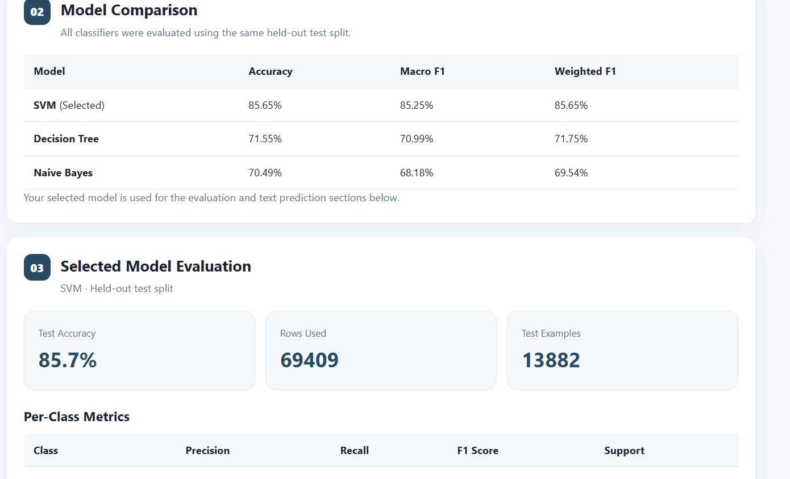

# Political Text Sentiment Analysis

A machine learning-based web application that analyzes political text and predicts its sentiment using Natural Language Processing (NLP). The application compares multiple machine learning classifiers, evaluates their performance, and automatically selects the best-performing model.

## Project Overview

Political discussions across online platforms contain different opinions, viewpoints, and expressions. This project uses NLP and machine learning techniques to analyze political text and classify its sentiment based on a labeled dataset.

Users can register and log in, upload a CSV dataset, train multiple machine learning models, compare their performance, and enter new political text to receive sentiment predictions.

## Features

- User registration and login authentication
- CSV dataset upload and validation
- Text preprocessing using TF-IDF vectorization
- Training and comparison of multiple machine learning classifiers
- Automatic model selection based on macro F1-score, with accuracy as a tie-breaker
- Model evaluation using accuracy, precision, recall, and F1-score
- Classification reports and confusion matrices
- Interactive sentiment prediction for new text
- Input validation and error handling

## Technologies Used

| Technology | Purpose |
|---|---|
| Python | Core programming language |
| Flask | Web application framework |
| Pandas | Dataset processing and manipulation |
| NumPy | Numerical operations |
| Scikit-learn | Machine learning algorithms and evaluation |
| TF-IDF | Text feature extraction |
| SQLite | User account database |
| HTML | Web page structure |
| CSS | User interface styling |

## Machine Learning Models

The application compares three machine learning algorithms:

1. **Support Vector Machine (SVM)** – LinearSVC classifier
2. **Decision Tree Classifier**
3. **Multinomial Naive Bayes**

The dataset is divided into training and testing sets. All three classifiers are evaluated using the same held-out test split to ensure a consistent comparison.

The application automatically selects the model with the highest macro F1-score. Accuracy is used as a tie-breaker.

## Model Comparison Results

The following results were obtained during one of the project test runs:

| Model | Accuracy | Macro F1 | Weighted F1 |
|---|---:|---:|---:|
| Support Vector Machine (SVM) | 85.65% | 85.25% | 85.65% |
| Decision Tree | 71.55% | 70.99% | 71.75% |
| Multinomial Naive Bayes | 70.49% | 68.18% | 69.54% |

Based on these evaluation results, SVM was automatically selected for this dataset.

### Model Comparison Screenshot



### Selected Model Evaluation

- **Selected Model:** SVM
- **Test Accuracy:** 85.7%
- **Rows Used:** 69,409
- **Test Examples:** 13,882

*Note: These results are specific to the dataset and test split used in this run. Model performance may vary with different datasets.*

## Project Structure

```text
Political_Security_Project/
│
├── app.py
├── sentiment_model.py
├── requirements.txt
├── README.md
├── .gitignore
│
├── users.db
│
├── data/
│   └── .gitkeep
│
├── static/
│   └── style.css
│
├── templates/
│   ├── auth.html
│   └── index.html
│
└── screenshots/
    └── model-comparison.png
```

## Installation and Setup

Follow these steps to run the project locally.

### 1. Clone the Repository

```bash
git clone https://github.com/NikithaButtlagunta/political-security-threat-prediction.git
```

### 2. Navigate to the Project Directory

```bash
cd political-security-threat-prediction
```

### 3. Create a Virtual Environment

```bash
python -m venv .venv
```

### 4. Activate the Virtual Environment

For Windows PowerShell:

```powershell
.venv\Scripts\Activate.ps1
```

### 5. Install Dependencies

```bash
pip install -r requirements.txt
```

### 6. Run the Application

```bash
python app.py
```

### 7. Open the Application

Open your browser and visit:

```text
http://127.0.0.1:5000
```

## How to Use the Application

1. Register a new account or log in.
2. Upload a labeled CSV dataset.
3. Select the appropriate text and sentiment-label columns.
4. Train the machine learning models.
5. Compare the performance of the three classifiers.
6. Review the selected model's evaluation metrics and confusion matrix.
7. Enter political text into the prediction section.
8. View the predicted sentiment.

## Evaluation Metrics

The application uses the following metrics to evaluate model performance:

- **Accuracy:** Measures the proportion of correctly classified test examples.
- **Precision:** Measures how many predicted class labels were correct.
- **Recall:** Measures how many actual class examples were correctly identified.
- **Macro F1-score:** Calculates the average F1-score across classes, treating each class equally.
- **Weighted F1-score:** Calculates the average F1-score while accounting for class support.
- **Confusion Matrix:** Shows correct and incorrect predictions for each class.

## Future Improvements

- Experiment with advanced NLP models such as BERT.
- Integrate larger and more diverse political datasets.
- Implement hyperparameter tuning to improve model performance.
- Add persistent storage for trained machine learning models.
- Improve model evaluation and visualization.
- Deploy the application to a cloud platform.

## Important Note

This project is intended for educational and research purposes. Sentiment analysis identifies the tone expressed in text; it does not establish factual accuracy, political intent, or whether an individual poses a real-world security threat.

## Author

**Nikitha Buttlagunta**

- GitHub: [NikithaButtlagunta](https://github.com/NikithaButtlagunta)
- Project Repository: [Political Text Sentiment Analysis](https://github.com/NikithaButtlagunta/political-security-threat-prediction)